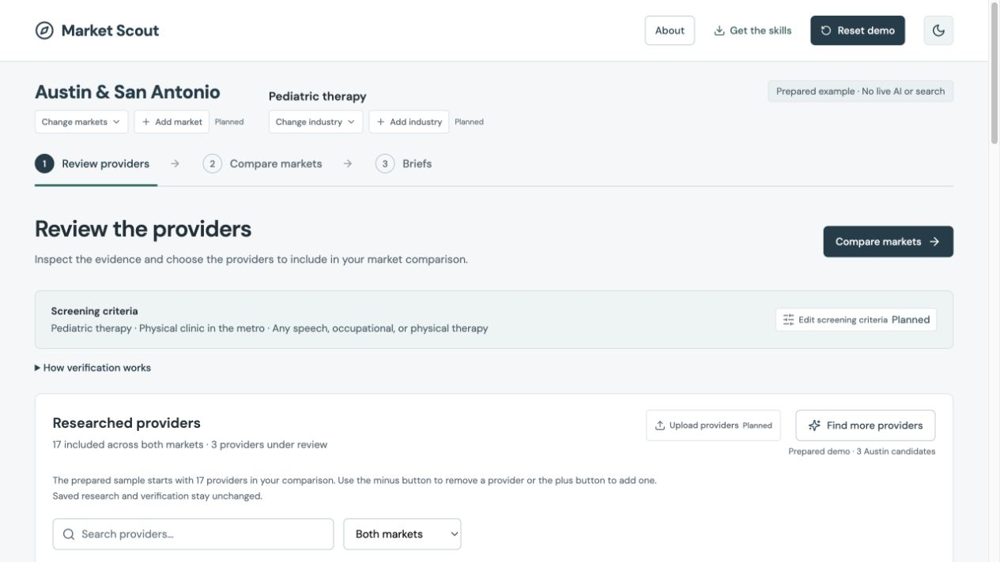

# Market Scout

**From sourced business research to a market comparison you can inspect.**

Market Scout helps investment teams research competitors across potential expansion markets. It combines a guided web demo with four reusable AI-assistant skills for discovering businesses, screening evidence, comparing markets, and writing research briefs.

[Explore the live demo](https://market-scout-roan.vercel.app/) · [Research SOP](docs/SOP.md) · [Get started with the skills](docs/CLI.md)



## What it does

The dashboard follows a simple workflow: **Review providers → Compare markets → Generate a brief.**

- **Inspect the research.** Open a provider to see source passages, documented locations, services, and verification checks.
- **Build a working comparison.** Include or exclude providers while keeping analyst decisions separate from evidence assessments.
- **Explore market differences.** Compare clinic locations on a map, services offered together, shared operators, and population context.
- **Read the analysis.** Generate a prepared brief on expansion strategy, competitor benchmarks, or research priorities; export research to CSV and save briefs as Markdown or PDF.

The live demo presents pediatric therapy in Austin and San Antonio. Discovery and brief generation use prepared examples; the reusable skills support other industries and markets through case configurations.

## Four connected skills

Each skill calls the same TypeScript CLI and saves artifacts that the next stage can reuse. The assistant collects sources and writes analysis; the CLI validates records, applies screening rules, calculates comparisons, and checks citation references.

| Skill | Purpose | Output |
| --- | --- | --- |
| [`research-market`](skills/research-market/SKILL.md) | Define a case and collect sourced business records | Research dataset, evidence, and duplicate-review notes |
| [`screen-providers`](skills/screen-providers/SKILL.md) | Apply the case's eligibility and geographic rules | Match / exclude / uncertain assessments and a review queue |
| [`compare-markets`](skills/compare-markets/SKILL.md) | Compare the reviewed businesses across markets | Calculated comparisons, CSV, and a briefing evidence pack |
| [`write-market-brief`](skills/write-market-brief/SKILL.md) | Turn the evidence into a decision-oriented memo | A sourced Markdown brief and reusable JSON artifact |

Configure the industry, research question, markets, capabilities, evidence scope, and comparison groups in a case file. Company-wide claims, physical locations, and service coverage stay distinct throughout the workflow.

The [configuration guide](docs/CASE-CONFIG.md) explains the format. The [walkthrough](docs/WALKTHROUGH.md) includes pediatric therapy and a fictional commercial-HVAC practice case. Local skill outputs currently live in files; full dashboard integration is on the roadmap.

## Run locally

Requires **Node.js 22**, npm, and **Python 3** for packaging the skills bundle.

```sh
git clone https://github.com/drat-git/market-scout.git
cd market-scout
npm ci
npm run dev
```

Open the URL printed by Vite. The demo needs no API key or database.

To use the skills in **Codex**, copy the four folders inside `skills/` into the project's `.agents/skills/` directory and start a new session. Try:

> Use $research-market to set up a case comparing commercial HVAC businesses in Phoenix and Tucson. Define the screening criteria, collect sources, and prepare the candidates for review.

See [installation and CLI commands](docs/CLI.md) for the full workflow, example prompts, and Claude Code setup. Codex is the tested assistant environment.

```sh
npm run scout -- --help  # Inspect the research CLI
npm test                # Run the automated checks
npm run package:skills  # Rebuild the downloadable bundle
npm run build           # Type-check and build the web app
npm run preview         # Serve the production build locally
```

## Project structure

| Directory | Contents |
| --- | --- |
| `src/` | React dashboard and guided demonstration |
| `toolkit/` | Configurable research, screening, comparison, and briefing logic |
| `cli/` | Command-line entrypoints and saved-run handoffs |
| `skills/` | Four assistant skills, references, and metadata |
| `cases/` and `examples/` | Case configurations and research inputs |
| `shared/` and `data/` | Prepared demo logic, evidence, briefs, and geographic context |
| `tests/` | Workflow, evidence, comparison, and export checks |
| `docs/` | SOP, configuration guide, methodology, and attribution |

Built with React, TypeScript, Vite, Zod, and Leaflet. Hosted on Vercel. See [deployment instructions](docs/DEPLOYMENT.md) for the production workflow. Earlier live-backend experiments are retained separately in `server/` and documented in [server notes](docs/SERVER.md).

## Built on Nico Goldberg's work

Market Scout adapts the modular sourcing approach in [Nico Goldberg's opensourcing-release](https://github.com/nicogoldberg1-rgb/opensourcing-release): staged research, explicit screening checks, saved handoffs, and domain normalization. It redirects that workflow from acquisition sourcing toward competitor and expansion-market research, adding branch-aware evidence, configurable comparisons, and the guided dashboard.

The [attribution map](docs/ATTRIBUTION.md) distinguishes adapted logic, adapted instructions, and conceptual inspiration. This is an independent project; the clinic example was informed by Oaklin Lane's published services.

Original code is available under the [MIT License](LICENSE). Upstream notices are preserved in [third-party notices](docs/THIRD_PARTY_NOTICES.md); cited source material retains its original rights.
