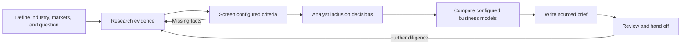

# Market Scout research SOP

Use this process to research a competitive landscape for an investment team, compare relevant business configurations, and prepare a sourced memo. The four skills work across configured industries and markets. The demo case covers Austin/San Antonio pediatric therapy.

**Deliverables:** a case definition, traceable business research, screening/review decisions, reproducible comparisons, and a question-specific brief.

The assistant gathers sources and writes analysis. The offline CLI validates and calculates. The analyst controls inclusion and reviews conclusions. The public demo remains a separate prepared illustration.

[Setup and commands](CLI.md) · [Case configuration](CASE-CONFIG.md) · [Practice walkthrough](WALKTHROUGH.md) · [Audit](SKILL-AUDIT.md) · [Nico's attribution](ATTRIBUTION.md)



## 1. Define the research case

Create `.market-scout/<case>/config.json` using the [configuration guide](CASE-CONFIG.md). Use existing user choices and ask only about material unknowns. Capture:

- The industry, intended business model, and question the research should answer.
- One or more named markets with explicit geographic boundaries.
- Attributes to establish: services, products, customer segments, capabilities, or other relevant qualitative facts.
- Screening criteria, including whether evidence must apply to the company, one site, or one service area.
- Comparison groups that would help the decision, with explicit scope.
- Optional sourced market context, retaining geography, period, units, and uncertainty.

Also write `case-note.md` with the audience, research limit, supplied sources, authorized inclusion policy, and information outside scope. Do not copy pediatric, population, payer, clinic, or ownership assumptions into an unrelated case. Markets can be outside the US; their boundaries still need verification.

For example, commercial HVAC research may require maintenance and installation coverage for commercial customers; a bakery case may require production and wholesale supply at one site. The toolkit's rules support all/any tests of explicit facts, not arbitrary numeric financial models.

A question like “Which market should we enter?” may exceed public competitor evidence. Frame the supported component and state which demand, staffing, cost, or commercial data would be needed for a final decision.

## 2. Research businesses — `research-market`

Use the [research skill](../skills/research-market/SKILL.md) and [batch contract](../skills/research-market/references/evidence-and-batches.md). Inspect an existing run if extending a case.

Record queries, dates, sources, selection rationale, exclusions, and stopping conditions in `research-method.md`. Use comparable methods across markets. Quality matters more than a target number of businesses.

For each candidate, establish identity, market connection, and configured facts. Verify boundary membership; a keyword in a marketing headline is insufficient. Keep general company offerings separate from capabilities at a site or in a service area. Record new branches under the same business rather than inflating company counts.

Save short exact passages with source URL or document reference, date, scope, verification, and uncertainty. Use only real retrieved/supplied passages. A directory can identify a lead without establishing every claim; missing information is unknown, not negative evidence. Keep company-name/domain collisions for review rather than automatic merging.

```sh
npm run scout -- research --case .market-scout/case/config.json --input .market-scout/case/batch.json --out .market-scout/case/research-01
```

For additions, replace `--case` with `--from <prior-run>`. Omit input to initialize an empty case while collecting sources. No demo data or demographics are inherited. All newly added records start unreviewed. Inspect warnings and preserved dates.

**Ready to screen:** facts are traceable to appropriately scoped records, identity questions are documented, and search coverage/limits are stated.

## 3. Screen evidence — `screen-providers`

```sh
npm run scout -- screen --from .market-scout/case/research-01 --out .market-scout/case/screen-01
```

Read `screen.json`, `verification.json`, and `review.csv`. The engine applies the case's source policy and criteria using stored evidence; it does not browse.

A match means all requirements are supported at an eligible scope. An uncertain result names a missing/conflicting fact. Exclusion requires affirmative contradiction. For same-site or same-area requirements, all required facts must coexist at that one scope. General company menus do not satisfy local rules.

Use `decisionChecks`/`decisionScope` for a concise explanation and `groups` to inspect alternatives. Another branch's unresolved fact need not block a business that has one qualifying site. A useful explanation names the missing fact and the specific evidence needed to resolve it.

If criteria change, save a separate override and advance its version. Re-screen before interpreting new eligibility. If evidence changes, revise a dataset copy through research. Do not modify a saved run in place.

## 4. Apply analyst decisions

| Concept | Meaning |
| --- | --- |
| Source verification | Whether the passage supports the specific claim/scope |
| Screening | Whether configured eligibility is established, uncertain, or contradicted |
| Inclusion | Whether the analyst wants the company–market record in the comparison |

Apply explicit decisions or an already authorized policy. A screening match is not automatic human approval. If the policy is missing, show the queue and leave candidates pending; independent work on accepted records may continue. Do not repeatedly request approval for choices already authorized.

Save a separate decisions file using actual relationship IDs:

```json
{"business@market-one":"accepted","other@market-two":"excluded"}
```

Unmentioned decisions inherit. Acceptance does not verify unresolved facts. Document consequential exceptions and the authorizing person/policy in the case note. An accepted uncertain business contributes supported information while retaining its gaps.

## 5. Compare markets — `compare-markets`

```sh
npm run scout -- compare --from .market-scout/case/screen-01 --selection .market-scout/case/decisions.json --out .market-scout/case/compare-01
```

Omit the override if nothing changed. Inspect `compare.json`, `brief-input.json`, and `research.csv`.

Choose analyses that address the case question: named operating comparators, site distribution, service coverage, shared operators, and evidence completeness. Profile scope matters: a company-wide capability is not a same-site offering. Location, company, and service-coverage measures are distinct and can overlap. CSV row count is not company count.

State sample denominators. Locality labels are not catchments or municipal GIS. Missing capabilities are not evidence of unmet demand. Market context must have compatible definitions, dates, and sources before numeric comparisons are meaningful.

One market supports a single-market result. A missing/empty market is a research gap, not zero competition. With no accepted businesses, return to review rather than writing a substantive market conclusion.

## 6. Author the brief — `write-market-brief`

Copy `narrative.template.json` outside its run. Preserve `caseId`, `datasetVersion`, `contextHash`, and the exact `comparison`. Read the [writing guide](../skills/write-market-brief/references/writing-and-citations.md).

Lead with the answer and its limits. Name the businesses/scopes behind the finding, explain cautious implications, consider alternative explanations, and order follow-ups by what could change the next decision. Use the industry's relevant terms rather than inherited example language.

Every material factual claim needs appropriate source support. The brief pack contains selected business sources and explicit IDs for configured market context. Do not use excluded-business facts, fabricated quotations, or unrelated citations. Treat unresearched staffing, pricing, margins, demand, licensing, or capacity as questions.

```sh
npm run scout -- brief --from .market-scout/case/compare-01 --narrative .market-scout/case/narrative-v1.json --out .market-scout/case/brief-01
```

Without a narrative, this produces a calculated summary, not a finished analytical memo. A valid source ID alone does not prove the prose is supported.

## 7. Review and hand off

Read `brief.md` as its recipient would. Verify the passages, scopes, dates, numbers, tables, source register, limitations, and usefulness of next steps. Distinguish the assistant's own review from independent analyst approval.

Deliver the memo, comparison CSV, method/case notes, review decisions, and self-contained run directories. Identify the remaining questions most likely to change the next decision. No publication, provider contact, or message sending is implied by this process.

## Revisions and boundaries

- New facts/sites: append a batch from the prior run, then screen and compare.
- Corrected facts: revise a full dataset copy and use `--data`; batch import refuses conflicting overwrites.
- Changed case/question: revise the configuration and use `--case` with the same case ID and prior run. Revisit inclusion decisions; active criteria come from the revised case unless explicitly overridden.
- New industry or unrelated research purpose: start a new case ID instead of mixing incompatible research.
- Changed inputs: regenerate comparison and re-check prose. The fingerprint includes configuration, evidence, criteria, and decisions.
- Failed/partial execution: preserve the directory and use a new output name. `run.json` is written last.
- Missing sources: retain uncertainty; never present saved evidence as newly researched.

Current capabilities are evidence-based qualitative screening and descriptive comparisons. Full dashboard integration, unattended monitoring, automatic ingestion of arbitrary spreadsheets, and numeric underwriting models are planned.
